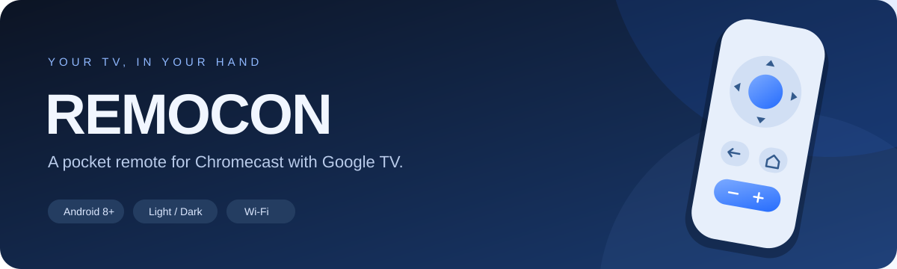
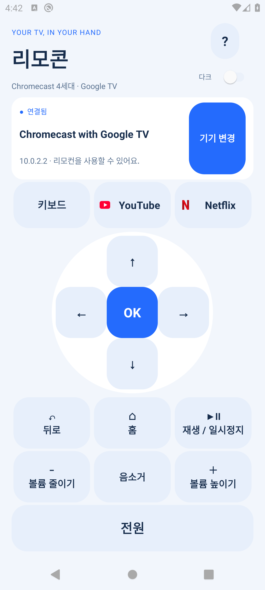
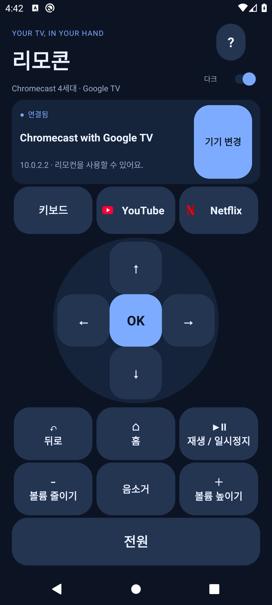
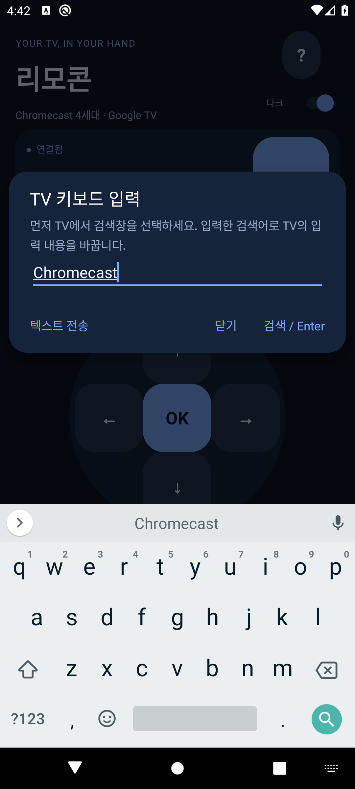

<div align="center">



# 리모콘

**Chromecast 4세대를 내 휴대폰으로.**<br>
파란색 라이트·다크 테마와 검색어 입력을 갖춘 Android Wi-Fi 리모컨


### [⬇ Android APK 다운로드](https://github.com/sung-gyeonghun/Chromecast_remote/raw/refs/heads/main/artifacts/remocon-0.3.0.apk)

**v0.3.0 · 약 3.6 MB · Android 8.0 이상**<br>
[설치 방법](#-설치와-연결) · [주요 기능](#-주요-기능) · [키보드 검색](#-키보드로-검색하기) · [직접 빌드](#build)

</div>

---

## ✨ 화면 미리보기

<table>
  <tr>
    <th align="center">Light</th>
    <th align="center">Dark</th>
    <th align="center">Keyboard</th>
  </tr>
  <tr>
    <td width="33%"></td>
    <td width="33%"></td>
    <td width="33%"></td>
  </tr>
</table>

> 화면은 로컬 테스트 서버에 연결한 Android 에뮬레이터에서 촬영했습니다.

## 📲 설치와 연결

**휴대폰에서 위의 [APK 다운로드](https://github.com/sung-gyeonghun/Chromecast_remote/raw/refs/heads/main/artifacts/remocon-0.3.0.apk) 링크를 열면 설치 파일을 받을 수 있습니다.**

1. 다운로드한 `remocon-0.3.0.apk`를 엽니다.
2. Android가 요청하면 다운로드에 사용한 브라우저 또는 파일 관리자에 **알 수 없는 앱 설치**를 허용합니다.
3. 휴대폰과 Chromecast를 **같은 Wi-Fi**에 연결합니다.
4. 앱에서 **기기 연결**을 누르고 Chromecast를 선택합니다.
5. **TV에 표시된 6자리 코드**를 입력하면 연결됩니다.

자동 검색이 안 되면 **IP 직접 입력**을 이용하세요. Chromecast의 설정 → 네트워크에서 IPv4 주소를 확인할 수 있습니다. 기존 0.1.0 사용자는 앱을 삭제하지 않고 업데이트 설치할 수 있습니다.

| 준비물 | 요구 사항 |
| :--- | :--- |
| 휴대폰 | Android 8.0 이상 |
| 기기 | Chromecast with Google TV, 4세대 4K/HD 대상 |
| 네트워크 | 휴대폰과 Chromecast가 통신할 수 있는 동일 Wi-Fi |
| 별도 설정 | Google 계정 로그인, ADB 디버깅, TV에 별도 앱 설치 불필요 |

> [!IMPORTANT]
> 현재 APK는 **개발용 서명 버전**입니다. 에뮬레이터와 테스트 서버 검증은 완료했지만 실제 Chromecast에서는 아직 검증하지 않았습니다. 설치 후 방향키·확인·홈부터 확인해 주세요. Google 공식 앱이 아닙니다.

## 🎛 주요 기능

| 기능 | 사용할 수 있는 것 |
| :--- | :--- |
| **기기 연결** | 자동 검색, IP 직접 입력, TV 코드 페어링 |
| **탐색** | 위·아래·왼쪽·오른쪽, 확인, 뒤로, 홈 |
| **미디어** | 재생 / 일시정지, 볼륨 조절, 음소거, 전원 키 |
| **키보드** | 검색어 작성, 텍스트 전송, 검색 / Enter |
| **앱 바로가기** | YouTube · Netflix 실행 요청 |
| **테마** | 파란색 라이트·다크 모드, 선택 저장 |
| **재연결** | 앱을 다시 열 때 저장된 기기에 연결 |

**테마 전환:** 오른쪽 위 **물음표 아래 ‘다크’ 토글**을 켜면 다크 모드, 끄면 라이트 모드입니다. 처음 실행할 때는 휴대폰 시스템 테마를 따르며, 변경한 선택은 저장됩니다.

**한 화면 구성:** 메인 화면에 스크롤을 사용하지 않습니다. 키보드·YouTube·Netflix를 한 줄로 배치하고, 방향 패드와 버튼 영역은 화면 크기에 맞춰 조절합니다.

**YouTube / Netflix:** TV에 해당 앱이 설치된 상태에서 버튼을 누르면 TV 앱에 실행 요청을 보냅니다. 휴대폰의 YouTube / Netflix 앱을 실행하는 기능이 아닙니다. TV의 앱 바로가기 지원 여부와 실제 설치 상태에 따라 결과가 달라질 수 있습니다.

## ⌨ 키보드로 검색하기

1. 리모컨으로 TV 앱의 **검색창을 먼저 선택**합니다.
2. 휴대폰 앱의 **키보드**을 누릅니다.
3. 휴대폰 키보드로 검색어를 작성합니다.
4. 원하는 전송 방법을 선택합니다.

| 버튼 | 동작 |
| :--- | :--- |
| **텍스트 전송** | 작성한 문자열을 TV로 전달 |
| **검색 / Enter** | 문자열 전달 후 Enter 키 전송 |
| **휴대폰 키보드의 검색 키** | 검색 / Enter와 같은 동작 |

전송한 문자열은 TV 입력 내용을 바꾸는 방식입니다. TV에서 입력 정보가 전달되지 않았거나 키보드를 지원하지 않으면 안내가 표시됩니다. **텍스트 입력과 Enter 처리 방식은 TV 앱마다 달라질 수 있습니다.**

## 💡 연결이 안 될 때

| 증상 | 확인할 것 |
| :--- | :--- |
| 기기를 찾지 못함 | 같은 Wi-Fi인지 확인하고 IP 직접 입력 시도 |
| 연결 시간이 초과됨 | TV 전원, VPN, 게스트 Wi-Fi / AP 격리 확인 |
| 코드가 맞지 않음 | TV에 현재 표시된 6자리 코드 재입력 |
| 인증서가 변경됐다고 표시됨 | 기기를 확인한 뒤 다시 페어링 |
| 검색어가 입력되지 않음 | TV에서 검색창 선택, 해당 앱의 키보드 입력 지원 확인 |
| 전원·볼륨이 반응하지 않음 | TV / Chromecast의 HDMI-CEC 및 볼륨 제어 설정 확인 |

전원·볼륨 버튼은 네트워크 키 명령입니다. 물리 리모컨의 적외선을 복제하지 않으므로 TV 설정에 따라 효과가 다를 수 있습니다. **음성 입력, TV 입력 전환, 장시간 누르기, 백그라운드 연결**은 현재 지원하지 않습니다.

<details>
<summary id="build"><strong>🔧 직접 빌드하기</strong></summary>

### 준비

- Java 17 이상
- Android SDK 플랫폼 35 및 빌드 도구
- Gradle Wrapper 8.11.1, Android Gradle Plugin 8.9.1 — 프로젝트에 설정 포함

프로젝트 루트에 `local.properties`를 만들고 자신의 Android SDK 경로를 지정합니다.

```properties
sdk.dir=C:/Users/사용자/AppData/Local/Android/Sdk
```

### Windows PowerShell

```powershell
git clone https://github.com/sung-gyeonghun/Chromecast_remote.git
cd Chromecast_remote
.\scripts\build.ps1
```

스크립트는 APK 빌드, 단위 테스트, Lint를 실행한 뒤 결과를 `artifacts/remocon-0.3.0.apk`에 복사합니다. 한글 경로에서 Gradle 테스트 워커가 클래스를 찾지 못하는 문제를 피하기 위해 빌드 출력은 `%LOCALAPPDATA%/RemoconBuild`에 저장합니다.

### macOS / Linux

```bash
bash ./gradlew assembleDebug testDebugUnitTest lintDebug
```

결과는 `app/build/outputs/apk/debug/app-debug.apk`에 생성됩니다.

</details>

<details>
<summary><strong>🧪 검증 범위와 구현 근거</strong></summary>

- 프로토콜 프레이밍, 오류 데이터, 페어링 해시, 한글 IME 메시지의 **단위 테스트 7개 통과**
- **Android Lint 오류 0개** 및 APK 서명 검사 통과
- 에뮬레이터에서 테마 전환·선택 저장·업데이트 설치 확인
- 로컬 TLS 테스트 서버에서 페어링, 핑, 12개 리모컨 키, 텍스트 및 Enter 전송 확인

[0.3.0 검증 기록](artifacts/verification-0.3.0.md) · [APK SHA-256](artifacts/remocon-0.3.0.sha256)

통신 구현은 공개 [androidtvremote2](https://github.com/tronikos/androidtvremote2/tree/e664a8e1f14ee458b14c646bfb3ea46f10367051)의 프로토콜 구현과 스키마를 참고해 Java로 작성했습니다. Google TV / Google Home 앱이나 실제 기기 트래픽을 REA로 분석해서 만든 것은 아닙니다. REA는 이전 0.1.0 APK의 패키지 구조 검사에 사용했습니다.

**테스트 서버 검증은 실제 Chromecast 및 TV 앱별 호환성을 보증하지 않습니다.**

</details>

<details>
<summary><strong>🔒 인증 정보와 사용 라이브러리</strong></summary>

TV 코드를 두 TLS 인증서의 RSA 공개키에 결합해 검증한 후 TV 공개키를 저장합니다. 이후 제어 연결에서 TV 공개키가 달라지면 거부합니다. 인증서와 개인키는 휴대폰의 앱 내부 저장소에 보관하며 백업 / 기기 전송에서 제외합니다.

로컬 네트워크 통신은 페어링 `6467/TCP`, 제어 `6466/TCP`, 검색 mDNS를 사용합니다. 기기 IP가 바뀌면 새로운 주소로 연결 / 페어링이 필요할 수 있습니다.

인증서 생성에는 Bouncy Castle 1.78.1을 사용합니다. [라이선스](app/src/main/assets/licenses/bouncycastle-license.html)는 APK에도 포함되어 있습니다.

</details>

---

<div align="center">

**휴대폰 하나로, TV를 조금 더 편하게.**<br>
[APK 다운로드](https://github.com/sung-gyeonghun/Chromecast_remote/raw/refs/heads/main/artifacts/remocon-0.3.0.apk) · [문제 제보](https://github.com/sung-gyeonghun/Chromecast_remote/issues)

</div>
